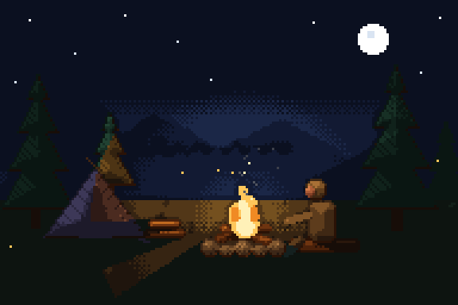
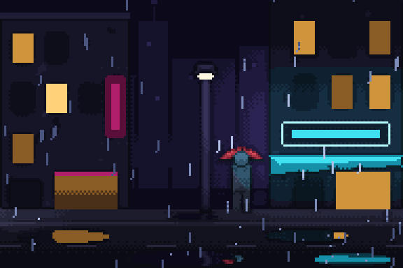
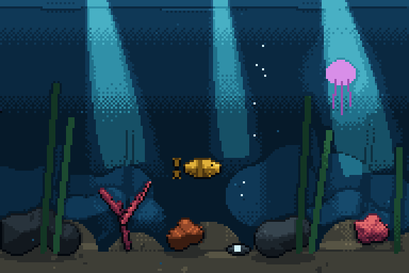
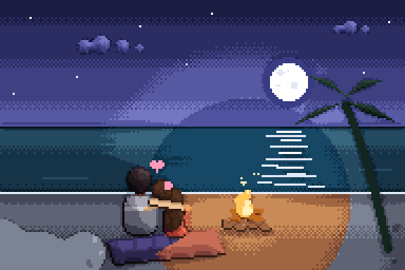
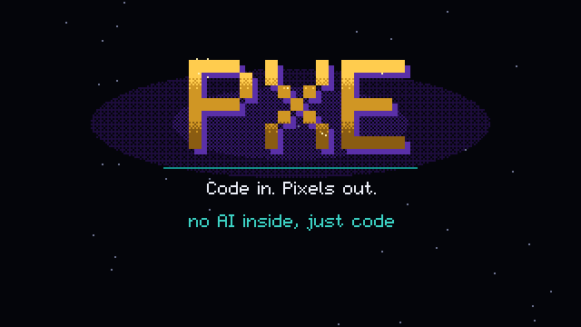

# animations-ngine

**A pixel art engine that renders scenes, characters, animations and game assets from text.** You describe a scene in [KDL](https://kdl.dev); a palette-indexed Rust core turns it into clean, looping pixel art. No drawing skills needed and no AI inside the engine: every pixel comes from geometry, palettes and pixel-art cleanup rules, and the same file always renders the same frames.

<table>
  <tr>
    <td></td>
    <td></td>
  </tr>
  <tr>
    <td></td>
    <td></td>
  </tr>
</table>

<sub>Every animation above is a single `.kdl` file in [`examples/`](examples), exported with `cargo pxe export`.</sub>

## Trailer

The engine's own trailer, made with the engine: one sequence of shots in [`examples/trailer.kdl`](examples/trailer.kdl). Title cards type themselves in, KDL types itself into an editor and becomes a koi, the showcase scenes play each feature in their own palettes, and the wordmark closes it.

<!-- Trailer video: replace the poster below with the github.com/user-attachments link of the uploaded MP4. -->
[](examples/trailer.kdl)

## Highlights

- **Describe, don't draw.** Rectangles, ellipses, polygons, blobs, capsules, thick lines and text, rasterized with orphan and notch cleanup, dome shading, outlines, textures and dithered gradients.
- **The palette is law.** Every pixel is a ramp plus a tone, so light, fog, mood and transitions are palette operations and the output never leaves the palette.
- **Animation as data.** Expressions (`y="=36 - abs(sin(t * pi)) * 26"`), keyframe tracks with easing, seeded randomness, noise, wind and perfect loops.
- **Light and atmosphere.** Ambient darkness, point and cone lights with cast shadows, emissive surfaces, reflections, fog and parallax.
- **Composition and sequences.** Place scenes inside scenes, attach objects to each other, animate a smooth re-rasterized camera zoom, and cut shots together with transitions into a trailer.
- **A pixel-art editor drawn by the engine.** `pxe edit` paints pixel layers, animates cels and edits the scene visually or as code, writing straight back to the KDL file.
- **Deterministic.** Integer frame time, counter-based seeded randomness and `libm` math; golden tests compare rendered buffer hashes.

## Quick start

The toolchain is pinned in [`rust-toolchain.toml`](rust-toolchain.toml); rustup installs it on the first build.

```bash
brew install rustup && rustup default stable   # or https://rustup.rs
git clone https://github.com/Coaxus-ux/animations-ngine.git
cd animations-ngine

cargo pxe export examples/hello.kdl            # → out/hello.gif
cargo pxe render examples/hello.kdl --frame 6  # → out/hello-6.png
cargo pxe watch examples/lantern-night.kdl     # live preview, reloads on save
cargo pxe edit examples/pixel-room.kdl         # the pixel-art editor
cargo pxe export examples/trailer.kdl --scale 2 --jobs 4   # the engine's own trailer
cargo pxe export examples/editor-trailer.kdl --scale 2     # the editor's trailer, 1280×720
tools/export_mp4.sh examples/editor-trailer.kdl tools/scores/editor_trailer.py out/editor-trailer.mp4   # as MP4 with its chiptune score (macOS)
```

`cargo pxe` is an alias for `cargo run --release -p px-cli --` ([`.cargo/config.toml`](.cargo/config.toml)).

A whole scene fits in a few lines ([`examples/hello.kdl`](examples/hello.kdl)):

```kdl
palette "hello" {
    ramp "sky"    "#0d1824" "#16273a" "#21384f" "#2e4c66" "#3f627f"
    ramp "ground" "#141c18" "#1e2a24" "#2b3a31" "#3a4c40"
    ramp "ball"   "#5a1f24" "#93323a" "#c95a4c" "#f08d6b" "#ffd2a8"
}

scene "hello" palette="hello" width=64 height=64 fps=12 duration="2s" loop=#true background="sky.shade" {
    rect x=0 y=48 width=64 height=16 paint="ground.base"
    ellipse x=27 y="=36 - abs(sin(t * pi)) * 26" width=10 height=10 paint="ball.base"
}
```

## Commands

| Command | What it does |
|---|---|
| `cargo pxe export <file.kdl>` | Render every frame to a looping GIF (`--scale`, `--param name=value`, `--jobs`) |
| `cargo pxe render <file.kdl> --frame N` | Render one frame to a PNG |
| `cargo pxe watch <file.kdl>` | Live preview window that reloads whenever the file changes |
| `cargo pxe edit <file.kdl>` | Open the pixel-art editor (`--size 64x64` creates a new file) |
| `cargo pxe timeline <file.kdl>` | Print placed scenes and markers on a time ruler |
| `cargo pxe bench` | Time every frame of the example scenes against a frame budget |

The full command design is in [docs/CLI.md](docs/CLI.md).

## Examples

| Scene | Shows |
|---|---|
| [`hello`](examples/hello.kdl) | The smallest scene: a bouncing ball |
| [`campfire-forest`](examples/campfire-forest.kdl) | Flickering light with cast shadows, sparks, smoke, fireflies |
| [`neon-rain`](examples/neon-rain.kdl) | Two neon light colors, reflections, rain, a passing car |
| [`coral-reef`](examples/coral-reef.kdl) | God rays, kelp, a fish school, a glowing jellyfish |
| [`moonlit-beach`](examples/moonlit-beach.kdl) | Characters, firelight against moonlight, waves |
| [`misty-lake`](examples/misty-lake.kdl) | Camera drift, parallax, fog, reflections with ripples |
| [`koi-pond`](examples/koi-pond.kdl), [`night-train`](examples/night-train.kdl), [`aurora-cabin`](examples/aurora-cabin.kdl), [`town-festival`](examples/town-festival.kdl) | Larger showcase scenes built from placed parts |
| [`trailer`](examples/trailer.kdl) | A sequence of shots and transitions |
| [`editor-trailer`](examples/editor-trailer.kdl) | The editor redrawn as scenes at 640×360, with Mount Fuji, the sunflower field and the fallen warrior playing inside it |
| [`typography`](examples/typography.kdl) | Text in the engine's pixel font |
| [`quote`](examples/quote.kdl) | A quote that types itself in: one card scene shot twice with different words and colors |

## Project layout

```
crates/
  px-core      no_std: ids, paints, palettes, canvas views, hashing
  px-expr      expression compiler and allocation-free evaluator
  px-raster    no_std: shape rasterization into a canvas
  px-format    KDL loading and validation into a compiled scene
  px-engine    renders a scene frame into an indexed canvas (no allocation)
  px-director  sequences: shots and transitions into frames
  px-export    indexed to RGB, upscaling, PNG, GIF
  px-ui        pixel-art UI toolkit drawn by the engine
  px-editor    the editor: domain, tools, views, app
  px-cli       the `pxe` binary
examples/      sample scenes and the trailer sequence
docs/          design documents
tools/         local checks (size guard, commit guard, check.sh)
```

## Documentation

Start at [docs/README.md](docs/README.md) for the reading order. The most useful entry points:

- [FORMAT.md](docs/FORMAT.md): the KDL format and expression language; [appendix A](docs/FORMAT.md#appendix-a-what-the-loader-accepts-today) lists what the loader accepts today
- [EDITOR.md](docs/EDITOR.md): the editor, starting with what `pxe edit` does today
- [ARCHITECTURE.md](docs/ARCHITECTURE.md): how the workspace fits together
- [ROADMAP.md](docs/ROADMAP.md): milestones and current status

## Status

**M1 done, with parts of M2–M5 and M9 pulled forward.** KDL scenes with expressions, keyframes, SDF shapes, form shading, outlines, textures, layers with parallax, clips, lights with cast shadows, fog, reflections, particles and ropes render to PNG stills and seamless looping GIFs, with a live preview. Scenes can span files and place other scenes on a timeline, the camera zooms smoothly, and pixel-font text plus sequences of shots make whole films. TypeScript behaviors are planned. The format is not stable yet; see [ROADMAP.md](docs/ROADMAP.md).

## Contributing

See [CONTRIBUTING.md](CONTRIBUTING.md). In short: run `tools/check.sh` before every push (no hosted CI, D-006), follow [CLAUDE.md](CLAUDE.md) and [RUST-STANDARDS.md](docs/engineering/RUST-STANDARDS.md), and never add AI agent signatures to commits (D-005).
