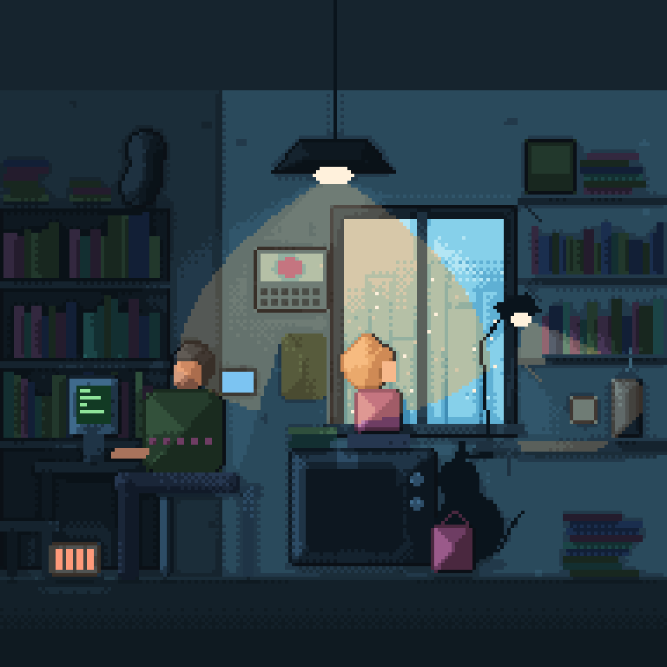

# B1: cozy night room

The [B1 benchmark](../../docs/BENCHMARKS.md) rebuilt at two engine stages, with the same composition, to measure progress.

| M1 baseline | M2/M4 re-attempt |
|---|---|
|  |  |

- [m1-attempt.kdl](m1-attempt.kdl) from [generate.py](generate.py): rectangles, ellipses, 1-px lines, expressions, ranges, params and references (348 shapes).
- [m2-attempt.kdl](m2-attempt.kdl) from [generate_m2.py](generate_m2.py): adds lights with warm twin ramps and cast shadows, ambient darkness and occlusion, dome shading, outlines, wall texture, gradients, rounded rects, capsules, polygons, blobs, a clipped window with rain particles, ropes for the cat tail and steam, emissive screens, and flickering tone shifts.

Both are generated only because the engine has no `repeat` yet.

```bash
python3 benchmarks/b1-cozy-room/generate_m2.py benchmarks/b1-cozy-room/m2-attempt.kdl
cargo run -p px-cli -- export benchmarks/b1-cozy-room/m2-attempt.kdl
```

## Assessment

**M1 baseline (2026-10-28): about 40% of the reference.** Composition, palette mood and small loops worked; light was faked with 1-px rows.

**M2/M4 re-attempt (2026-10-28): about 55–60%.** The room now has real light: a warm pendant cone with soft dithered edges, a desk lamp tinting the shelves, screens and heater that glow, furniture that casts shadows, and contact shadows that ground objects. Surfaces read as volumes (dome shading, selective outlines), and the rain stays inside the window.

Still missing, by visual impact:

| Gap | Milestone |
|---|---|
| Characters with faces, hair, posture (figures are still stacked shapes) | M6 |
| Small details (glasses, calendar picture, keyboard) | M6 pieces |
| Repetition (`repeat`, `scatter`, prefabs) instead of a generator | M3 |
| Bounce light on the floor and soft ambient fill | M4 follow-up |
| Hand-tuned palette roles (the warm twins are computed, not designed) | M2 palettes |
