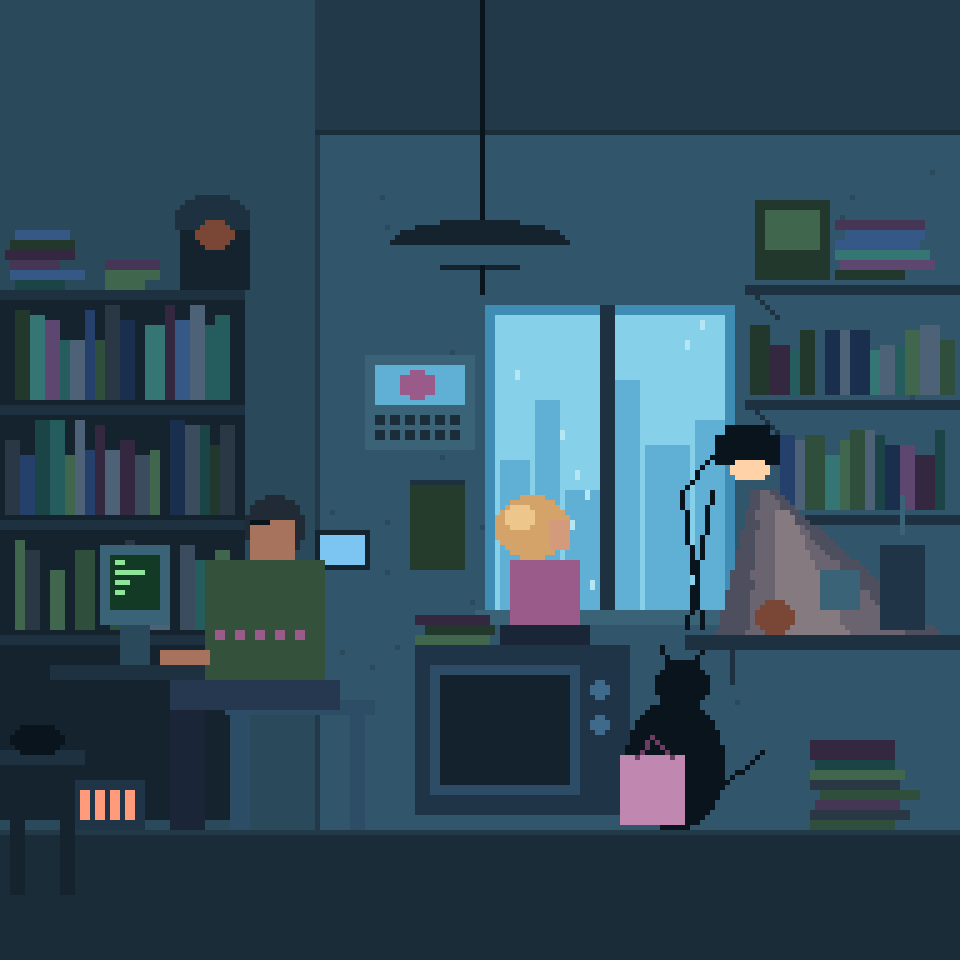

# B1 baseline: cozy night room

The [B1 benchmark](../../docs/BENCHMARKS.md) rebuilt with **M1 features only** (rectangles, ellipses, 1-px lines, expressions, ranges, params and references), as a starting point to measure later milestones against.



- [m1-attempt.kdl](m1-attempt.kdl): 348 shapes, 192×192, 2 s loop (rain, monitor text, typing hand, cat tail, steam).
- [generate.py](generate.py) writes the scene; it exists only because the engine has no `repeat` yet.

```bash
python3 benchmarks/b1-cozy-room/generate.py benchmarks/b1-cozy-room/m1-attempt.kdl
cargo run -p px-cli -- export benchmarks/b1-cozy-room/m1-attempt.kdl
```

## Assessment (2026-10-28): about 40% of the reference

Composition, palette mood and small loops work. Missing, by visual impact:

| Gap | Milestone |
|---|---|
| Lighting: warm cone tinting surfaces, soft falloff | M4 |
| Dithering, gradients, texture noise | M2 |
| Shapes beyond boxes, ellipses and 1-px lines | M2 |
| Characters with faces, hair, posture | M6 |
| Outlines and cleanup passes | M2 |
| Small details (glasses, calendar picture) | M6 pieces |
| Repetition (`repeat`, `scatter`, prefabs) | M3 |
| Animatable colors (flicker, glow) | to add to M1 slice 3 |
| Clipping to a region (rain inside the window) | M2/M3 |
